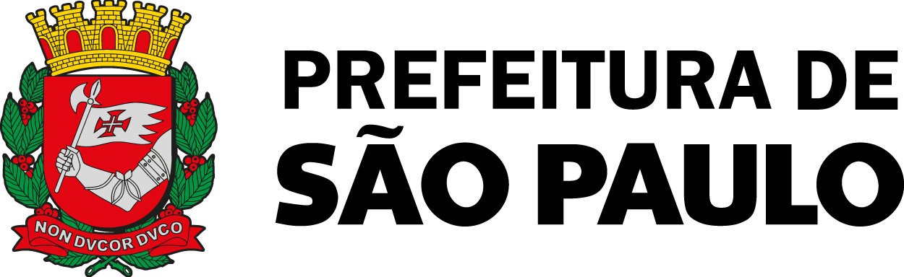
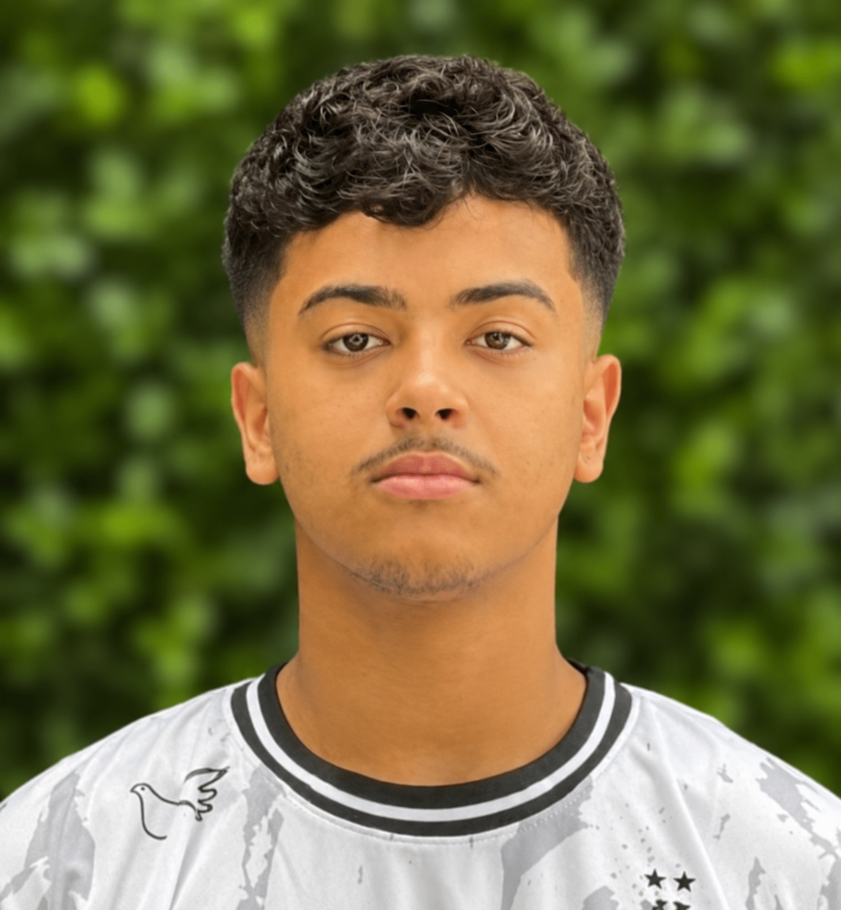

# SampaReport

> **Zeladoria inteligente e transparente para a cidade de São Paulo.**

O SampaReport é uma plataforma de participação cidadã criada para aproximar os moradores da Prefeitura. A aplicação permite registrar problemas de infraestrutura urbana, acompanhar o andamento das solicitações e validar a solução apresentada pelo poder público.

## Identidade visual

> **Campo para os ícones do projeto:** substitua a imagem abaixo por uma composição com os ícones finais da aplicação, quando estiver disponível.

<p align="center">
  
</p>

## Objetivo

O projeto busca diminuir a lentidão e a falta de transparência dos chamados de infraestrutura urbana que atualmente ocorrem pelo portal SP156. Com evidências, geolocalização e participação da comunidade, um relato cotidiano pode se transformar em uma ação pública verificável.

### Como funciona

1. O cidadão publica um problema com localização e evidências.
2. A comunidade valida o chamado por meio de upvotes.
3. Ao atingir cinco upvotes, o chamado é encaminhado para homologação da Prefeitura.
4. A equipe técnica executa o reparo e envia a evidência da solução.
5. O cidadão confirma a resolução e avalia o serviço de zero a cinco.

## Funcionalidades principais

- Cadastro e acompanhamento de ocorrências urbanas.
- Feed comunitário de problemas reportados.
- Geolocalização dos chamados.
- Filtro comunitário com validação por upvotes.
- Fluxo de status do chamado, da publicação à conclusão.
- Auditoria cidadã com evidências de antes e depois.
- Avaliação do serviço realizado.
- Páginas institucionais de início, sobre, FAQ, contato e integrantes.

## Tecnologias

| Camada | Tecnologias |
| --- | --- |
| Frontend | React, TypeScript, Vite e Tailwind CSS |
| Navegação | React Router DOM |
| Ícones | React Icons |
| Backend/API | Java 25, Spring Boot, MVC, BO e DAO |
| Banco de dados | Oracle SQL e integridade referencial |
| APIs e nuvem | OpenStreetMap e Cloudinary |

## Estrutura do projeto

```text
src/
├── assets/                 # Imagens, fotos e recursos visuais
├── components/             # Componentes reutilizáveis da interface
├── pages/
│   ├── app/                # Telas da plataforma
│   └── institucional/     # Home, sobre, FAQ, contato e integrantes
├── types/                  # Tipos compartilhados
├── App.tsx                 # Rotas principais
├── index.css               # Estilos globais
└── main.tsx                # Ponto de entrada da aplicação
```

## Como executar

### Pré-requisitos

- Node.js instalado.
- npm instalado.

### Instalação

```bash
git clone https://github.com/GustavoSilva-dev/SampaReport.git
cd SampaReport
npm install
```

### Desenvolvimento

```bash
npm run dev
```

Depois, acesse a URL exibida pelo Vite no terminal, normalmente `http://localhost:5173`.

### Build de produção

```bash
npm run build
```

### Verificação de lint

```bash
npm run lint
```

## Demonstração da aplicação

### Tela inicial

> **Campo para print 1:** substitua o caminho abaixo pelo print da tela inicial ou da página institucional.


### Plataforma e feed de ocorrências

> **Campo para print 2:** substitua o caminho abaixo pelo print do feed ou do fluxo de abertura de chamado.


## Links

- **Repositório GitHub:** [GustavoSilva-dev/SampaReport](https://github.com/GustavoSilva-dev/SampaReport)
- **Aplicação publicada na Vercel:** _inserir URL da publicação_
- **API Java:** _inserir URL do repositório ou documentação da API_
- **Vídeo de apresentação no YouTube:** _inserir URL do vídeo de até três minutos_

## Integrantes

| Foto | Integrante | RM / Turma | Função | LinkedIn | GitHub |
| --- | --- | --- | --- | --- | --- |
|  | **Gustavo Soares Silva** | RM573880<br>1TDSR | Desenvolvedor | [LinkedIn](https://www.linkedin.com/in/gustavo-silva-23575638b/) | [GustavoSilva-dev](https://github.com/GustavoSilva-dev) |
|  | **Edilson Condori** | RM571464<br>1TDSR | Desenvolvedor | [LinkedIn](https://www.linkedin.com/in/edilson-condori/) | [Edilson-Cm](https://github.com/Edilson-Cm) |
|  | **Brayan dos Santos Sousa** | RM564317<br>1TDSR | Desenvolvedor | [LinkedIn](https://www.linkedin.com/in/brayan-dos-santos-sousa/) | [Brayan511](https://github.com/Brayan511) |
|  | **Breno Henrique de Castro Rocha** | RM572922<br>1TDSR | Desenvolvedor | [LinkedIn](https://www.linkedin.com/in/breno-henrique-de-castro-rocha-79b24b24b/) | [BrenoRocha1](https://github.com/BrenoRocha1) |

## Status do projeto

Projeto acadêmico desenvolvido pela equipe da FIAP para a Global Solution.

---

Desenvolvido com propósito coletivo para tornar os problemas da cidade mais visíveis, acompanháveis e solucionáveis.
